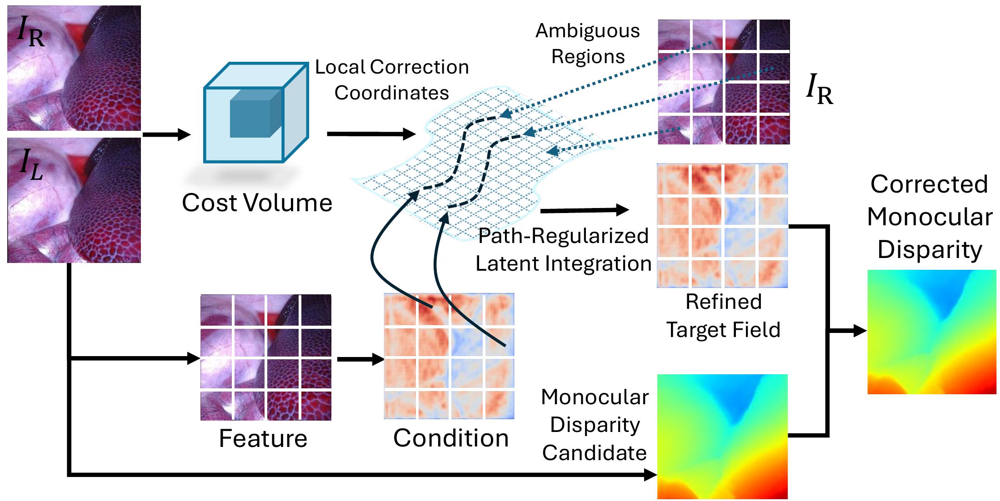
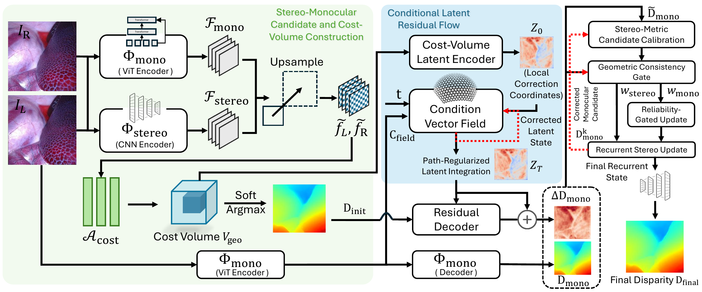

<h1 align="center">
  Manifold-Guided Stereo-Monocular Refinement<br>
  for Endoscopic Stereo Disparity Estimation
</h1>

<p align="center">
  <a href="#method">Method</a> ·
  <a href="#setup">Setup</a> ·
  <a href="#training">Training</a> ·
  <a href="#evaluation">Evaluation</a> ·
  <a href="#citation">Citation</a>
</p>

Manifold-Stereo combines calibrated stereo geometry with monocular depth priors for endoscopic disparity estimation. It refines a monocular candidate in a **cost-volume-induced local correction space**, then controls its contribution through **geometric consistency-gated recurrent refinement**.

## Method



**Figure 1 — Motivation.** Local latent corrections use stereo evidence to refine a monocular candidate in regions with ambiguous correspondence. [Original PDF](assets/figures/figure1_motivation.pdf)



**Figure 2 — Framework.** Stereo and monocular candidate construction, conditional latent residual flow, and reliability-gated recurrent refinement. [Original PDF](assets/figures/figure2_overview.pdf)

- **Local correction:** an image-aligned latent field encodes stereo cost-volume geometry.
- **Residual refinement:** a conditional latent trajectory decodes corrections to the monocular candidate.
- **Reliability gating:** stereo-scale alignment and geometric consistency regulate the candidate during recurrent updates.

The model is implemented in [core/endo_stereo_fm.py](core/endo_stereo_fm.py). Class and configuration names retain the original `EndoStereoFM` / `flow_matching` identifiers; the method uses a conditional latent residual flow.

## Setup

Run the following commands from a machine with an NVIDIA GPU and a driver compatible with CUDA 11.8:

```bash
git clone https://github.com/Jiewen-Yang/Manifold-Stereo.git
cd Manifold-Stereo

# The current training environment used by this project
conda activate Manifold_Stereo
python -m pip install torch==2.0.1 torchvision==0.15.2 --index-url https://download.pytorch.org/whl/cu118
python -m pip install "numpy<2" "opencv-python<4.12" scipy scikit-image pillow imageio \
    matplotlib tqdm opt_einsum lz4 pyyaml hydra-core omegaconf accelerate==1.0.1 wandb torchdiffeq
```

### Prepare weights and data

1. Download the **Depth Anything V2 ViT-L** weights from the [upstream repository](https://github.com/DepthAnything/Depth-Anything-V2#pre-trained-models), then set `depth_ckpt` in the training configuration to the local checkpoint path. The default configuration uses `encoder: vitl`.
2. Prepare rectified **SCARED** image pairs and disparity maps. The dataset readers for SCARED, Hamlyn, and SERV-CT are in [core/stereo_datasets.py](core/stereo_datasets.py).
3. Update [config/train_scared.yaml](config/train_scared.yaml):

```yaml
scared_root: /public2/mvicgs4/jyangcu/zy/dataset/scared
depth_ckpt: /path/to/depth_anything_v2_vitl.pth
save_path: ./checkpoints/scared/
```

<details>
<summary>SCARED directory layout</summary>

```text
SCARED/
├── train_data/                       # dataset_1, dataset_2, dataset_3, dataset_6, dataset_7
│   └── dataset_1/keyframe_1/data/
│       ├── left_rectified/000001.png
│       ├── right_rectified/000001.png
│       └── disparity/000001.png
└── test_data/                        # dataset_8 and dataset_9
    └── dataset_8/keyframe_0/data/
        ├── left_rectified/000001.png
        ├── right_rectified/000001.png
        └── disparity/000001.png
```

The loader scans the configured directories directly; it does not use split-list
files. Training contains only `dataset_1`, `dataset_2`, `dataset_3`, `dataset_6`,
and `dataset_7`, while testing contains only `dataset_8` and `dataset_9`. Only
complete left/right/disparity triplets are kept. Disparity PNGs are decoded with
a scale factor of 1/64.

</details>

Model checkpoints and datasets are not included in this repository. The Depth
Anything V2 checkpoint specified by `depth_ckpt` is required when initializing
the model for both training and evaluation.

## Training

After configuring the local paths above, launch training from the repository root:

```bash
CUDA_VISIBLE_DEVICES=0,1 WANDB_MODE=offline \
accelerate launch --multi_gpu --num_processes 2 --mixed_precision fp16 \
    train_scared.py --config-name train_scared
```

With the default configuration, the global batch size is 8, so two processes
use four samples per GPU. Checkpoints and validation logs are written to
`save_path`; checkpoints are saved every 2000 steps and the final checkpoint is
`final.pth`. Adjust GPU count, `batch_size`, and iteration settings for your
environment. Set `WANDB_DIR` to a path under `/public2` if the home-directory
quota is limited; remove `WANDB_MODE=offline` to use online Weights & Biases.

Two ablation configurations are included:

| Ablation | Hydra configuration name |
| --- | --- |
| Without geometric gating | `train_scared_exp01_no_geo_gating` |
| Without latent residual-flow correction | `train_scared_exp02_no_flow_matching` |

Select an ablation by changing `--config-name` in the training command.

## Evaluation

Use a trained Manifold-Stereo checkpoint and supply the dataset paths explicitly.
Run from the repository root after activating `ug_zy`:

```bash
# SCARED
python evaluate_scared.py --model_path /path/to/model.pth \
    --data_root /public2/mvicgs4/jyangcu/zy/dataset/scared \
    --config_path ./config/train_scared.yaml

# Hamlyn
python evaluate_hamlyn.py --model_path /path/to/model.pth \
    --data_root /path/to/Hamlyn

# SERV-CT
python evaluate_servct.py --model_path /path/to/model.pth \
    --data_root /path/to/SERV-CT
```

The SCARED evaluator requires `--batch_size 1` because it reads the calibration
matrix and groups results per frame. It accepts `--config_path`, `--device`, and
`--iters` (default: 32). Valid ground-truth disparities are in `[0.5, 192)`.
It reports EPE, Bad1, Bad2, Bad3, Bad5, Depth_MAE, Abs_Rel, Sq_Rel, RMSE,
RMSE_log, and Delta1/2/3. Results are first averaged within each
`dataset_*/keyframe_*`, then averaged across keyframes. JSON, keyframe CSV, and
dataset CSV files are written beside the checkpoint.

SCARED visualization uses the fixed `[0, 192]` disparity range and a JET
color map so colors are comparable between frames. Results are grouped under
`dataset_*/keyframe_*`; add `--save_raw_disp` to also write the predicted
uint16 disparity (`disparity * 64`) and `--colorbar` to save the matching
colorbar.

```bash
python vis_scared.py \
    --dataset scared \
    --model_path /path/to/model.pth \
    --data_root /public2/mvicgs4/jyangcu/zy/dataset/scared \
    --config_path ./config/train_scared.yaml \
    --output_dir ./visualizations/scared \
    --save_raw_disp --colorbar
```

The visualizer writes `gt`, `pred`, and `left` PNGs under
`dataset_*/keyframe_*`. `--save_raw_disp` additionally writes uint16 predicted
disparities using the SCARED encoding (`disparity * 64`). Use `--max_samples`
for a small smoke test before processing the complete test set.

## Citation

```bibtex
@inproceedings{yang2026manifoldstereo,
  title     = {Manifold-Guided Stereo-Monocular Refinement for Endoscopic Stereo Disparity Estimation},
  author    = {Yang, Jiewen and Zhong, Yi and Pu, Bin and Dong, Xingbo and Zheng, Ming and Lin, Qika and He, Kai and Zhang, Xuechen},
  booktitle = {Advances in Neural Information Processing Systems},
  year      = {2026}
}
```

## Acknowledgements and license

We thank [MonSter](https://github.com/Junda24/MonSter), [RAFT-Stereo](https://github.com/princeton-vl/RAFT-Stereo), [IGEV](https://github.com/gangweiX/IGEV), and [Depth Anything V2](https://github.com/DepthAnything/Depth-Anything-V2) for their open research and code.

See [LICENSE](LICENSE) for the included MonSter Model License; upstream components retain their respective licenses.

> MonSter model is licensed under the MonSter Model License, Copyright © Autel Robotics Co., Ltd. and Huazhong University of Science and Technology. All Rights Reserved.
